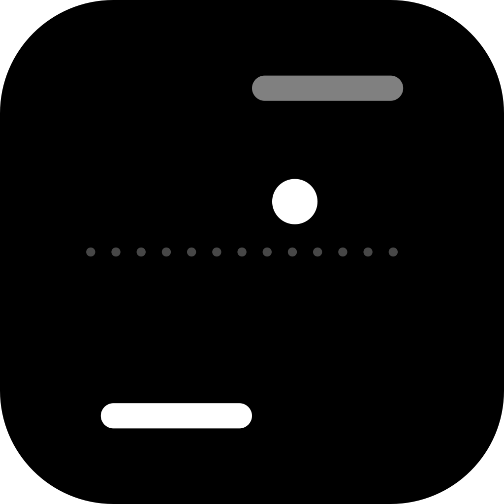
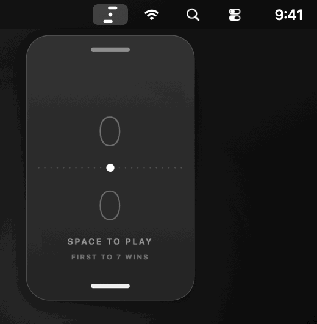

<p align="center">
  
</p>

<h1 align="center">Ping</h1>

<p align="center">
  A tiny ping-pong game that lives in your Mac's menu bar. Click the icon, play the bot, click away.
</p>

<p align="center">
  <a href="#install"><b>Install</b></a> ·
  <a href="#how-to-play"><b>How to play</b></a> ·
  <a href="#build-from-source"><b>Build from source</b></a> ·
  <a href="LICENSE"><b>MIT License</b></a>
</p>

<br>

Ping is a small menu bar app for Mac. Click its icon and a glass panel drops down with a vertical game of
ping-pong: you are the paddle at the bottom, the bot is at the top. First to 7 wins.

- A panel of Liquid Glass on macOS 26, and a frosted blur on earlier versions. Everything on it is drawn in the
  system text colour, so it follows light and dark mode by itself.
- No buttons and no chrome: a dotted centre line, two faint scores, two paddles and a ball.
- Three difficulty levels. The bot always returns a serve aimed at it, so it never looks silly on the first ball.
- A menu bar item and nothing else: no Dock icon, no windows left behind. The game freezes when you close the panel
  and uses no CPU while it is hidden.
- No account and no network access. It only remembers the difficulty you chose.

Requires macOS 14 or later (Apple Silicon and Intel).

<p align="center">
  
</p>

<p align="center">
  <sub><b>Click the icon</b> in the menu bar and the game drops down. The bot is above, you are below.</sub>
</p>

## Install

Open **Terminal** (Cmd+Space, type `Terminal`, press Return), paste this and press Return:

```bash
curl -fsSL https://raw.githubusercontent.com/hafizuddin-a/ping-pong-menubar/main/get.sh | bash
```

This downloads the latest release from GitHub, checks it against its published checksum, puts `Ping.app` in your
Applications folder and opens it. Look for the icon with two paddles and a ball in the menu bar. Files downloaded with
curl aren't quarantined, so there is no macOS warning to click through. The script is [`get.sh`](get.sh), about 50
lines, if you'd like to read it first. Run it again any time to reinstall the latest version.

**Or by hand** (no Terminal):

1. Download `Ping-<version>.zip` from the [Releases](../../releases) page and unzip it.
2. Drag `Ping.app` to your Applications folder.
3. Open it. macOS will say it can't verify the developer, because this app is not notarized by Apple:
   - **macOS 15 and later:** click Done, open **System Settings > Privacy & Security**, scroll down and click
     **Open Anyway** next to Ping, then open the app again.
   - **Earlier macOS:** right-click the app, choose **Open**, then **Open** again.

**Or build it yourself.** You need Xcode's command-line tools (`xcode-select --install`). In Terminal:

```bash
git clone https://github.com/hafizuddin-a/ping-pong-menubar.git
cd ping-pong-menubar
./install.sh
```

This builds `Ping.app`, puts it in `~/Applications` and opens it. Because the app is built on your own Mac, there is
no macOS "unidentified developer" warning to click through. See also [Build from source](#build-from-source).

## How to play

Left-click the icon to open the game. Click anywhere else, or press Esc, to close it.

| Key | What it does |
| --- | --- |
| **←** / **→** (or **A** / **D**) | Move your paddle. Pressing one also starts a new game or resumes a paused one |
| **Space** or **Return** | Start, resume, or play again after a match |
| **Esc** | Close the panel |

- The ball speeds up with every hit. Hit it with the edge of your paddle to angle the shot, and a moving paddle adds a
  little spin.
- Closing the panel pauses the game. When you open it again it says **SPACE TO RESUME**, and a ball that was waiting
  to be served is served when you do.
- You feel a small tap on the trackpad on hits and points.

## The menu

Right-click (or Control-click) the icon for the menu.

| Item | What it does |
| --- | --- |
| Difficulty | Easy, Normal or Hard (Normal by default). Changing it starts a new match |
| New Match | Resets the score |
| Launch at Login | Starts Ping when you log in |
| Quit Ping | Quits the app |

## What it can't do

- It is single player only: you against the bot.
- Launch at Login is most reliable once the app is in your Applications folder, which the curl install and
  `./install.sh` both do for you.
- It is not notarized, so macOS asks you to approve it the first time if you download it by hand (see Install).

## Build from source

You need Xcode's command-line tools (`xcode-select --install`).

```bash
git clone https://github.com/hafizuddin-a/ping-pong-menubar.git
cd ping-pong-menubar
./build.sh      # builds Ping.app (universal)
./build.sh run  # builds and opens it
./install.sh    # builds, installs to ~/Applications and opens it
./release.sh    # builds dist/Ping-<version>.zip and prints its SHA-256 for GitHub Releases
```

The whole app is three small files in [Sources](Sources): [Pong.swift](Sources/Pong.swift) is the game itself (physics,
scoring and the bot, with no AppKit in it), [GameView.swift](Sources/GameView.swift) draws it and reads the keys, and
[AppDelegate.swift](Sources/AppDelegate.swift) is the menu bar item and the glass panel.

`tools/make_assets.sh` redraws the logo, the app icon and the animation at the top of this page, using the app's real
renderer and bot.

Because the game is separate from the drawing, it can be simulated without a screen.
`./tools/simulate.sh` plays hundreds of matches per level with a scripted player and prints how often it wins, which
is how the three bot levels were tuned.

## Uninstall

Choose **Launch at Login** again to untick it if you ticked it, choose **Quit Ping**, then drag `Ping.app` out of
your Applications folder to the Trash. Ping saves nothing but your difficulty setting.
